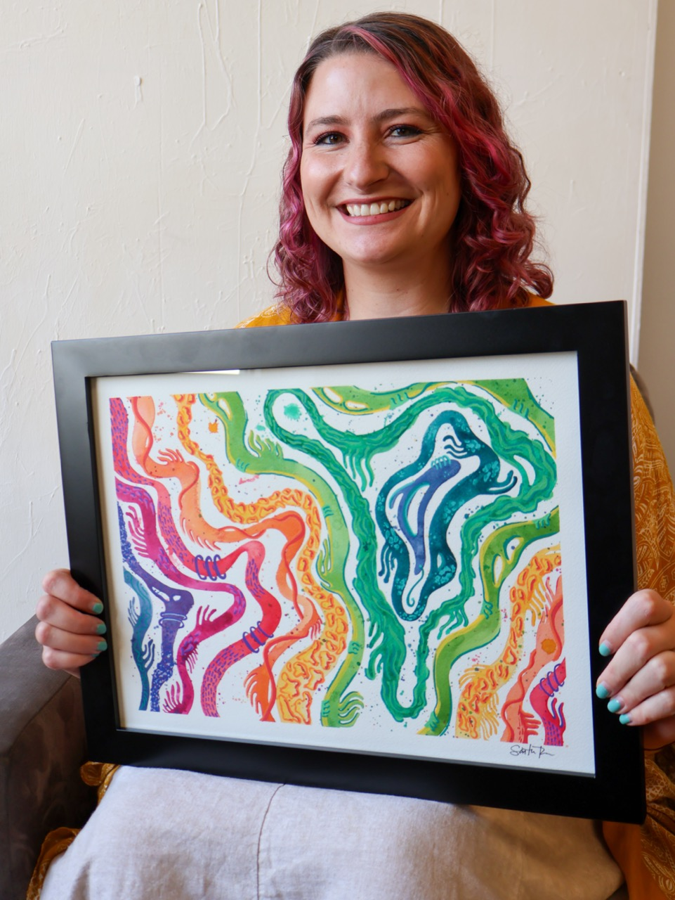
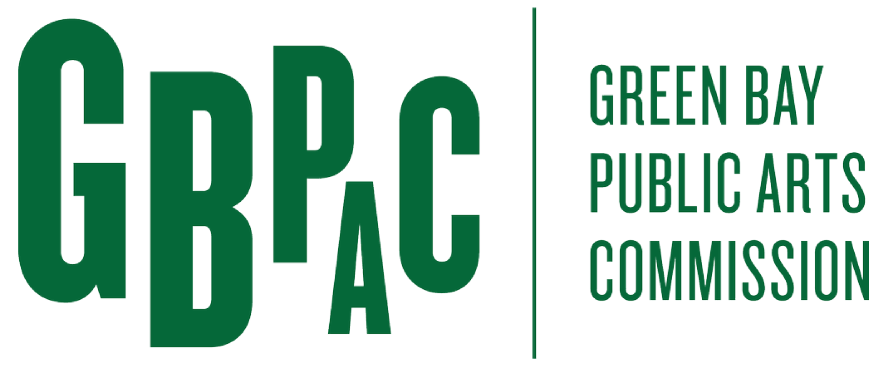
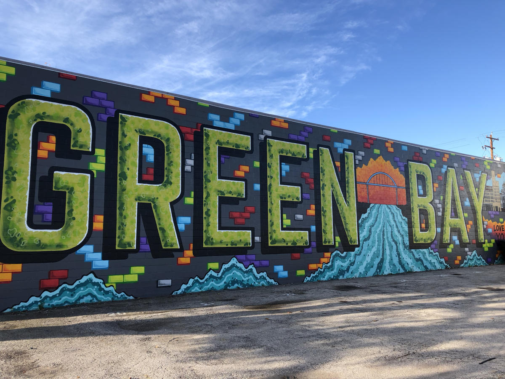
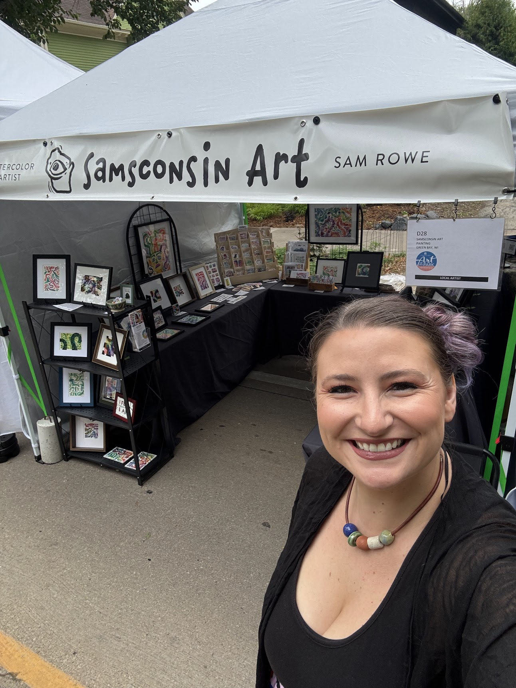

**GREEN BAY, Wis. (October 2026)** — Sam Rowe, Creative Director at Insight Creative, has been  named to the Green Bay Public Arts Commission, a five-member group dedicated to promoting  arts, culture and Green Bay’s creative identity. 

The Green Bay Public Arts Commission supports and advances public art throughout the  community through a variety of initiatives, including the Rotating Art Program, art grants,  permanent public art projects and other opportunities for artists and community members. Commission members are appointed by the Mayor and approved by the Green Bay Common  Council. Each member serves a 36-month term. 

As a new member of the commission, Rowe hopes to continue building on the work already  underway while expanding opportunities for the community to participate in the creative  process. 

“I’d like to continue the work the commission is currently doing and help grow it to include  more public art projects that involve the community making art,” said Rowe. "I encourage the  commission to focus even more on the benefits of creating art as a community in addition to  the permanence of public art." 

Rowe believes public art plays an important role in creating a vibrant and connected  community. 

“Public art is important to Green Bay because it breathes joy and soul into our surroundings,”  Rowe said. “Art and creative thinking make people more resilient, improve their well-being and  inspire folks to think differently and hopefully create more themselves.” 

Through her role at Insight Creative, Rowe brings a background in creative direction, design and  visual communication to the commission. She looks forward to using that experience to help  support and expand creative opportunities throughout Green Bay. 

To learn more about the Green Bay Public Arts Commission, visit: https://www.greenbaywi.gov/571/Public-Arts-Commission